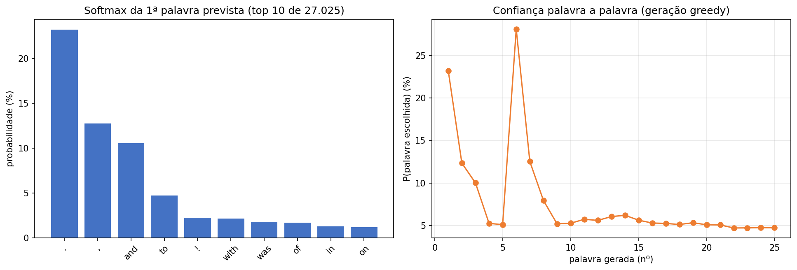

# 🧠 MiniGPT-TinyStories — Next-Word Prediction do Zero

> Um **Transformer (mini-GPT) construído 100% do zero em PyTorch** — sem bibliotecas de transformers, sem modelos pré-treinados — para prever a próxima palavra, treinado no dataset [TinyStories](https://huggingface.co/datasets/roneneldan/TinyStories) (Hugging Face), inteiramente em **Databricks CPU serverless**.


---



*Figura gerada pela STEP 14 do notebook — à esquerda, a distribuição softmax da 1ª palavra prevista (top 10 de 27.025 tokens: "." 23,2%, "," 12,7%, "and" 10,5%); à direita, a confiança do modelo palavra a palavra ao longo da geração autoregressiva greedy.*

## 🎯 O que este projeto demonstra

Do **dataset bruto à geração de texto**, com cada etapa validada e documentada:

1. **Engenharia de dados** — ingestão do Hugging Face para Delta bronze (2.141.709 histórias), EDA, tokenização word-level (27.025 tokens) e criação de 3,7M pares contexto→alvo.
2. **Modelo do zero** — Transformer decoder-only com 4,25M parâmetros implementado à mão em PyTorch: atenção causal multi-cabeça, blocos pre-LN, weight tying, inicialização estilo GPT-2.
3. **Treino com restrições reais** — 350 passos em CPU com orçamento de tempo, tracking em MLflow, artefactos em Unity Catalog (tabelas Delta + Volume).
4. **Método científico** — 5 perguntas de investigação com respostas quantificadas, incluindo uma prova de que o modelo aprende **ordem/gramática** e não só coocorrências.

## 📊 Resultados em 30 segundos

| Métrica | Antes do treino | Depois de 350 passos |
| --- | :---: | :---: |
| Perda de validação | 10,20 (≈ ln 27.025, aleatório) | **5,01** |
| Perplexidade | 27.025 | **150** |
| Precisão top-1 (validação) | ~0% | **15,8%** |
| P(palavra correta) média | 0,004% | **5,3%** |
| Ranking mediano da palavra correta | — | **14º** de 27.025 |

## 🏗️ Arquitetura do modelo

```
tokens → tok_emb (27.025×128) + pos_emb (16×128)
      → 4 × [ Atenção causal multi-cabeça (4 cabeças) → MLP 128→512→128 GELU ]  (pre-LN)
      → LayerNorm final → cabeça (weight tying) → softmax (27.025 palavras)
```

* **4.254.592 parâmetros** — cabeça de saída partilha os pesos do embedding (0 parâmetros extra)
* Máscara causal dinâmica (`mask[:T, :T]`) — funciona com qualquer comprimento de contexto ≤ 16
* Inicialização GPT-2 (std = 0,02) — verificável pela perda inicial ≈ ln(V) = 10,2
* Em CPU, a cabeça de saída é aplicada só na última posição: ~16× menos FLOPs, mesma arquitetura

## 🔄 Pipeline de dados

| Etapa | Descrição | Artefacto (Unity Catalog) |
| --- | --- | --- |
| Ingestão | TinyStories (HF) → Delta bronze | `tinystories_raw` (2.141.709 histórias) |
| Tokenização | Word-level, freq ≥ 5, minúsculas + pontuação, `<eos>` | `tinystories_vocab` (27.025), `tinystories_tokens` |
| Pares | Janela deslizante de 16 tokens → palavra seguinte | `tinystories_pairs_train` (3,7M), `..._val` (370k) |
| Treino | AdamW, lote 512, 350 passos, orçamento de tempo | `tinystories_treino_metricas` + pesos em UC Volume + MLflow |

## 🔬 Investigação — 5 perguntas, 5 respostas

1. **Mais contexto ajuda?** Sim — precisão top-1: 4,5% (1 palavra) → **15,8%** (16 palavras).
2. **O treino melhora a confiança?** Sim — P(palavra correta) no probe fixo: 0,0004 → 0,0015 (37× acima do aleatório); perplexidade 413 → 159.
3. **Que palavras são difíceis?** Correlação 0,84 entre frequência e facilidade. Fáceis: pontuação/stopwords. Difíceis: palavras frequentes mas dependentes do contexto ("all", "fun", "back").
4. **Gramática ou coocorrência?** Gramática — baralhar a ordem das palavras do contexto (mesmas palavras!) derruba P(correta) em **−63%**. A atenção captura estrutura, não um saco-de-palavras.
5. **Mais dados = melhor?** Só com mais computação — com os mesmos 120 passos, 25k pares (5,62) bateram 200k (5,72); com 350 passos, 5,01.

## ✍️ Geração de texto

Mecanismo autoregressivo clássico: tokenizar o prompt → modelo olha para os últimos 16 tokens → **softmax sobre todo o vocabulário** → escolher a palavra (greedy ou amostragem com temperatura) → acrescentar ao contexto → repetir até ao limite ou ao token de paragem `<eos>`.

```
PROMPT: once upon a time there was a little girl named lily . she loved to play
GERADO: . she was so happy. she was so so so ...
```

O texto é repetitivo — comportamento esperado de um modelo subtreinado (350 passos em CPU) — mas o mecanismo é exatamente o dos GPT reais: a qualidade escala com o treino.

## 📁 Estrutura do repositório

```
MiniGPT-TinyStories-Next-Word-Prediction-do-Zero/
├── MiniGPT-TinyStories.ipynb     # notebook completo — 16 células (STEP 0–15), executadas
├── README.md                     # este ficheiro
├── images/
│   └── geracao_softmax_confianca.png
├── requirements.txt              # dependências
├── LICENSE                       # MIT
└── .gitignore
```

O notebook é a documentação viva: cada célula tem cabeçalho com **objectivo, input, output e decisões de engenharia** (STEP 0–15: instalação → ingestão → EDA → vocabulário → tokenização → pares → modelo → treino → investigação ×5 → dataset → geração → conclusão).

## 🚀 Como reproduzir

1. Workspace Databricks com compute CPU serverless (sem GPU necessário).
2. Importe o notebook (`MiniGPT-TinyStories.ipynb`) e execute as células por ordem — o STEP 0 instala o PyTorch CPU e reinicia o Python.
3. Dependências entre células: investigação (STEP 7–12) e geração (STEP 14) requerem STEP 0 + STEP 5 (classes) + STEP 7 (modelo treinado carregado do Volume).
4. Tabelas Delta, pesos (`mini_gpt.pt`) e runs MLflow são criados automaticamente no seu Unity Catalog.

## 🛣️ Roadmap

- [ ] Treinar até convergência em GPU (milhões de passos sobre os 3,7M pares)
- [ ] Learning-rate scheduler (warmup + cosine) e early stopping
- [ ] Tokenização BPE/subword em vez de word-level
- [ ] Beam search e top-k sampling na geração
- [ ] Attention maps interativos (visualizar o que cada cabeça aprende)

## 📄 Licença

[MIT](LICENSE) — livre para estudar, adaptar e reutilizar.

---

*Construído fase a fase com validação de cada etapa — um projeto de portfólio sobre como os LLMs funcionam por dentro, num orçamento de CPU.*
